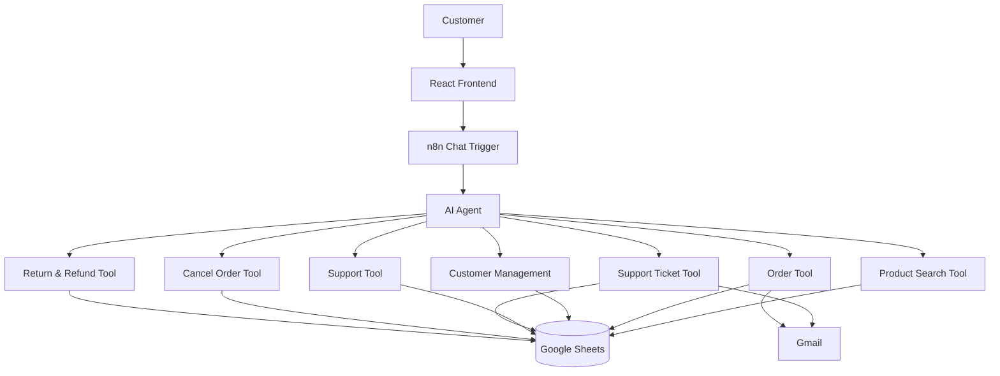

# ShopFlow AI
### AI-Powered Commerce & Customer Automation Platform

ShopFlow AI is a modern, AI-first conversational shopping and customer service automation platform. Instead of forcing shoppers through rigid e-commerce UI filters and slow support queues, ShopFlow AI connects users with an autonomous AI assistant powered by n8n and LangChain to search products, place orders, track shipments, safely cancel orders with automatic inventory restoration, and resolve customer issues.

---

## Overview

ShopFlow AI is an AI-powered commerce automation platform that allows customers to:

- Search products using natural language
- Get AI-powered product recommendations based on budget and preferences
- Place orders with live inventory verification
- Receive automated order confirmations
- Track orders and live carrier delivery milestones
- Check real-time delivery information and tracking IDs
- Cancel eligible orders with automatic stock replenishment
- Request returns/refunds within delivery SLA guidelines
- Create support tickets with automated severity assessment
- Automatically escalate high-priority support issues (payments, delays, damages)

---

## Architecture

```
Customer
   ↓
React Frontend
   ↓
n8n AI Customer Assistant
   ↓
AI Agent (LangChain)
   ↓
Specialized n8n Tools
   ↓
Google Sheets / Gmail
```

### Complete Workflow Interaction Diagram



---

## AI Agent Tools

The autonomous AI assistant coordinates 7 specialized n8n tools to execute business logic:

1. **Product Search Tool (`shopflow-product-search.json`)**: Performs semantic natural-language searches across the product catalog and applies numeric price caps (`max_price`).
2. **Order Tool (`shopflow-order-tool.json`)**: Verifies inventory availability, validates customer email and quantity, computes order totals, and reserves stock.
3. **Customer Management Tool (`shopflow-customer-management.json`)**: Automatically associates orders with existing customer profiles or registers new customers in the database.
4. **Support Tool (`shopflow-support-tool.json`)**: Fetches verified order status, delivery progress, carrier tracking numbers, and delivery date estimates.
5. **Support Ticket Tool (`shopflow-support-ticket-tool.json`)**: Generates unique ticket identifiers (`TKT-XXXXXX`), calculates priority dynamically, and dispatches email notifications via Gmail.
6. **Cancel Order Tool (`shopflow-cancel-order-tool.json`)**: Validates cancellation eligibility (only orders in `Confirmed` status can be cancelled) and restores reserved item stock to inventory.
7. **Return & Refund Tool (`shopflow-return-refund-tool.json`)**: Checks whether the order has reached `Delivered` status within policy guidelines and registers return and pending refund states.

---

## Tech Stack

### Frontend
- **Framework**: React 19
- **Language**: TypeScript 6
- **Build Tool**: Vite 8
- **Styling**: Tailwind CSS 3.4 (Custom Design System, Glassmorphism & Dark Mode)
- **Routing**: React Router DOM 7
- **Icons**: Lucide React

### Backend / Automation
- **Orchestration**: n8n Workflow Automation
- **AI Engine**: LangChain Agent Node (NVIDIA Nemotron / OpenAI LLM)
- **Memory**: Buffer Window Memory (Multi-turn session persistence)
- **Database**: Google Sheets (Inventory, Orders, Customers, Tickets)
- **Notifications**: Gmail Integration

---

## Features

- **Conversational Shopping Assistant (`/app`)**: Natural language chat interface with session continuity, typing indicators, structured in-chat product cards, and instant buy triggers.
- **Product Discovery (`/products`)**: Clean grid with multi-faceted search, category filtering, real-time price slider, and availability filters.
- **Orders Dashboard (`/orders`)**: Live KPI metrics (Total Orders, Active Orders, Delivered, Pending Returns) and responsive order management table.
- **Order Details (`/orders/:orderId`)**: Complete order breakdown with a multi-stage fulfillment timeline (*Order Placed -> Confirmed -> Processing -> Shipped -> Delivered*).
- **Logistics Tracking (`/track`)**: Order ID lookup with verified carrier milestones and estimated delivery dates.
- **Automated Support Center (`/support`)**: Instant ticket registration with automated NLP severity scoring (`High`, `Medium`, `Low`) based on issue keywords.
- **Returns & Refunds Hub (`/returns`)**: Self-service return eligibility verification with real-time return and refund tracking.
- **Complete Dark / Light Mode**: Seamless theme switching with electric indigo accent styling and local storage persistence.

---

## Project Structure

```
ShopFlow/
├── backend/
│   ├── shopflow-ai-customer-assistant.json
│   ├── shopflow-product-search.json
│   ├── shopflow-order-tool.json
│   ├── shopflow-customer-management.json
│   ├── shopflow-support-tool.json
│   ├── shopflow-support-ticket-tool.json
│   ├── shopflow-cancel-order-tool.json
│   └── shopflow-return-refund-tool.json
│
├── frontend/
│   ├── public/
│   │   └── favicon.svg
│   ├── src/
│   │   ├── components/
│   │   ├── context/
│   │   ├── data/
│   │   ├── layouts/
│   │   ├── pages/
│   │   ├── services/
│   │   ├── types/
│   │   ├── App.tsx
│   │   ├── index.css
│   │   └── main.tsx
│   ├── .env.example
│   ├── package.json
│   ├── package-lock.json
│   ├── tailwind.config.js
│   └── vite.config.ts
│
├── docs/
│   ├── architecture.md
│   └── N8N_INTEGRATION_GUIDE.md
│
├── README.md
├── .gitignore
└── LICENSE
```

---

## Local Setup

### Frontend

1. Navigate to the frontend directory:
   ```bash
   cd frontend
   ```

2. Install dependencies:
   ```bash
   npm install
   ```

3. Configure environment variables:
   Create `frontend/.env` based on `frontend/.env.example`:
   ```bash
   cp .env.example .env
   ```
   Set your n8n Chat Trigger webhook URL:
   ```env
   VITE_N8N_WEBHOOK_URL=YOUR_N8N_CHAT_TRIGGER_URL
   ```
   *(If left empty, the application automatically runs in client emulation mode for instant testing without an active backend).*

4. Run the development server:
   ```bash
   npm run dev
   ```

5. Build for production:
   ```bash
   npm run build
   ```

---

## n8n Setup

1. Import the workflow JSON files located in `backend/` into your n8n workspace:
   - `shopflow-ai-customer-assistant.json` (Main Agent)
   - `shopflow-product-search.json`
   - `shopflow-order-tool.json`
   - `shopflow-customer-management.json`
   - `shopflow-support-tool.json`
   - `shopflow-support-ticket-tool.json`
   - `shopflow-cancel-order-tool.json`
   - `shopflow-return-refund-tool.json`
2. Configure credentials locally within your n8n instance:
   - **Google Sheets OAuth2 API**: Access to your product catalog and orders sheet.
   - **Gmail OAuth2 API**: For automated email confirmations and ticket notifications.
   - **NVIDIA Nemotron / OpenAI API**: LLM model credential for the LangChain agent.
3. Activate the workflows in n8n.
4. Copy the webhook URL from the **When chat message received** node in the main assistant workflow and paste it into `frontend/.env`.

> **Note**: Never commit live API keys or credentials to Git. Credentials must always remain securely within your local n8n credential store.

---

## Security

- **Environment Variables**: Frontend endpoints are strictly configured through environment variables (`VITE_N8N_WEBHOOK_URL`).
- **No Secrets in Source Control**: Credentials, access tokens, OAuth secrets, and private keys are never committed to Git.
- **Workflow Architecture Only**: The exported n8n workflow JSON files contain nodes, connections, and metadata definitions without private keys.
- **Error Masking**: Internal backend exceptions, stack traces, and database identifiers are masked with friendly user-facing messages.

---

## Future Improvements

- **User Authentication**: Secure customer login via OAuth / Supabase / NextAuth.
- **Persistent Customer Dashboard**: Full user profile synchronization across multiple devices.
- **Real Database Integration**: PostgreSQL / Supabase migration from Google Sheets for high-throughput scaling.
- **Payment Gateway Integration**: Stripe / Razorpay direct checkout integration.
- **Production Cloud Deployment**: Containerized deployment on AWS / Vercel / Render.
- **Advanced Analytics & Reporting**: Real-time conversion funnels and conversation sentiment tracking.
- **Admin Dashboard**: Operational dashboard for store managers to manage orders, stock, and agent settings.
- **Multi-channel Support**: WhatsApp / Telegram bot connectors for omni-channel customer service.

---

## License

This project is licensed under the [MIT License](LICENSE).
