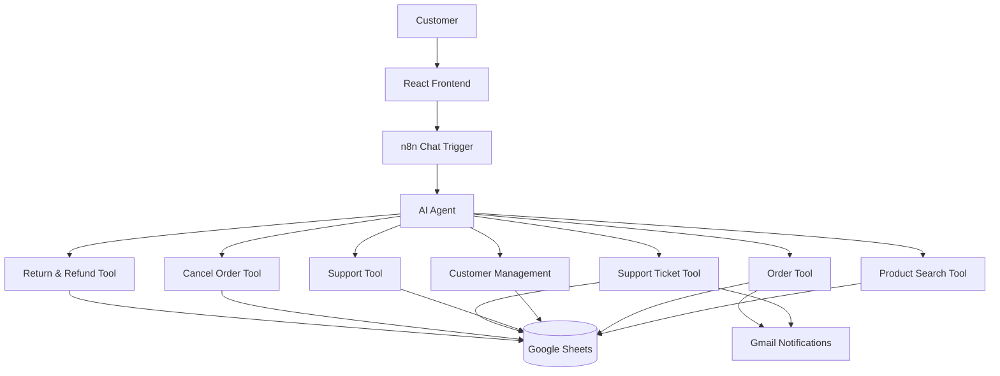

# ShopFlow AI — Complete Workflow Architecture

ShopFlow AI is an AI-powered conversational commerce and customer automation platform. It is engineered with an agentic architecture where a React frontend communicates with an autonomous n8n LangChain AI agent orchestrating specialized backend automation tools.

---

## 1. System Architecture Diagram

---

## 2. Component Breakdown

### 2.1 Customer & React Frontend
- **Framework**: React 19 + TypeScript + Vite + Tailwind CSS.
- **Client Service Layer (`n8nService.ts`)**: Transmits user prompts with a stateful session ID (`shopflow_session_id`) stored in `localStorage`.
- **UI Modules**:
  - `/app`: AI Assistant with real-time streaming, structured product card rendering, and suggestion chips.
  - `/products`: Live-filtered product catalog with category and price boundaries.
  - `/orders`: Order tracking dashboard with status badges and cancel/return actions.
  - `/orders/:orderId`: Visual fulfillment timeline and order breakdown.
  - `/track`: Direct carrier tracking ID lookup.
  - `/support`: Support center with automated NLP issue prioritization.
  - `/returns`: Self-service returns with 7-day SLA eligibility verification.

### 2.2 n8n Chat Trigger & LangChain AI Agent
- Node: `@n8n/n8n-nodes-langchain.chatTrigger` receives HTTP POST requests.
- Node: `@n8n/n8n-nodes-langchain.agent` (powered by NVIDIA Nemotron / OpenAI LLM).
- Node: `@n8n/n8n-nodes-langchain.memoryBufferWindow` maintains multi-turn context without asking customers for redundant parameters.

### 2.3 Specialized n8n Automation Tools

1. **Product Search Tool (`shopflow-product-search.json`)**:
   - Searches products by natural-language query and optional maximum budget (`max_price`).
   - Queries the Google Sheets inventory database and returns matched product names, IDs, prices, and available stock.

2. **Order Tool (`shopflow-order-tool.json`)**:
   - Accepts `product_id`, `quantity`, `customer_name`, and `customer_email`.
   - Validates available inventory stock. If stock is sufficient, creates an order ID (`ORD-${Date.now()}`), appends the order to Google Sheets, and updates inventory stock.

3. **Customer Management Tool (`shopflow-customer-management.json`)**:
   - Triggered automatically after successful order creation.
   - Looks up customer record by email in Google Sheets; increments `total_orders` and records `last_order_id` for existing customers, or creates a new customer profile.

4. **Support Tool (`shopflow-support-tool.json`)**:
   - Accepts `order_id`.
   - Fetches live fulfillment status, delivery status (`In Transit`, `Delivered`, etc.), carrier tracking ID, and estimated delivery dates from Google Sheets.

5. **Support Ticket Tool (`shopflow-support-ticket-tool.json`)**:
   - Accepts `customer_name`, `customer_email`, `order_id`, `issue`, and `priority`.
   - Generates a unique ticket reference (`TKT-${Date.now()}`), registers it in the support registry, and triggers automated email dispatch via Gmail.

6. **Cancel Order Tool (`shopflow-cancel-order-tool.json`)**:
   - Accepts `order_id`.
   - Verifies that the order is still in `Confirmed` status. If eligible, changes status to `Cancelled` and restores the item quantity back into product inventory stock.

7. **Return & Refund Tool (`shopflow-return-refund-tool.json`)**:
   - Accepts `order_id`.
   - Verifies if the order is in `Delivered` status. If eligible, updates `return_status` to `Return Requested` and `refund_status` to `Pending`.

---

## 3. Security & Data Protection

- **No Hardcoded Credentials**: API tokens, credentials, and OAuth secrets are configured within n8n's secure credential store and are not committed to source control.
- **Client Isolation**: The frontend only communicates via the configurable `VITE_N8N_WEBHOOK_URL` endpoint.
- **Graceful Error Sanitization**: Internal workflow node names, raw stack traces, and database URLs are never exposed to the end user.
